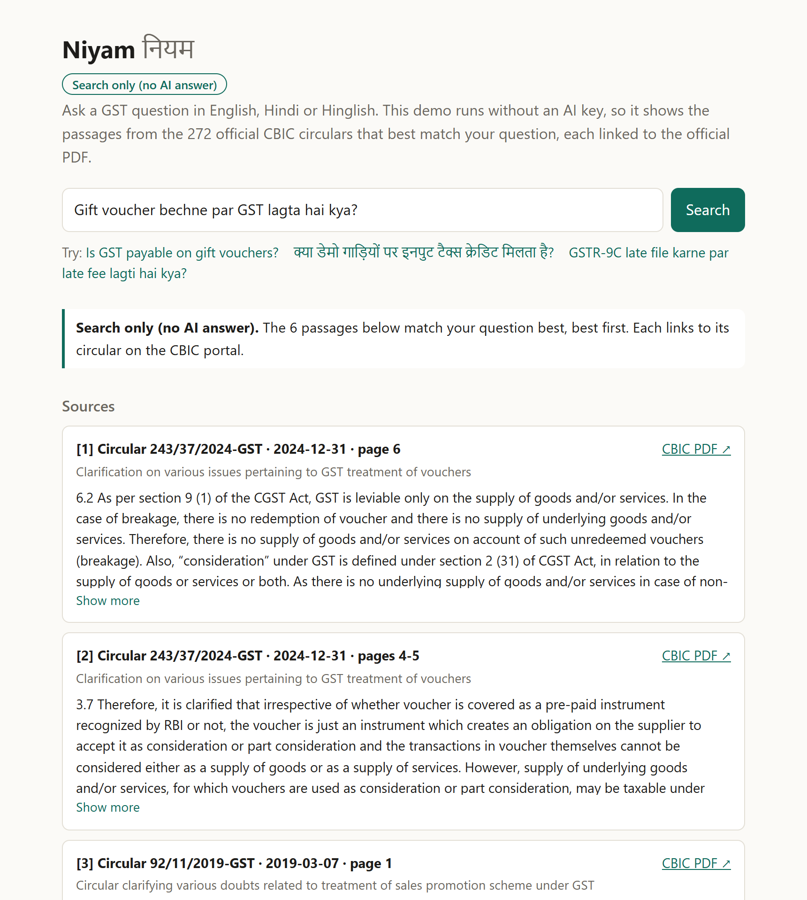
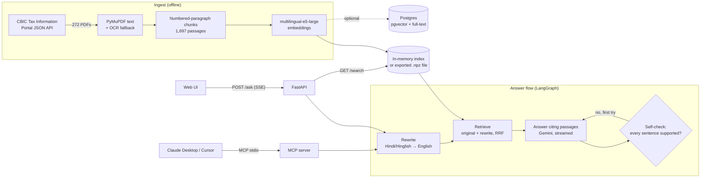

# Niyam

Answers GST questions in Hindi, English or Hinglish from the official CBIC circulars, with a citation for
every claim. *Niyam* (नियम) means "rule".

Small-business owners in India ask GST questions the way they speak ("Gift voucher bechne par GST lagta
hai kya?"), while the answers sit in 272 English circulars written in legal language. Niyam searches all
of them, answers in the question's language, cites the circular, date and pages for each sentence, checks
that every sentence is supported by the passage it cites, and says so when the circulars don't cover the
question.

- **Search** across all 272 CBIC GST circulars (2017–2026), 1,697 passages, in about 0.1 s on a laptop CPU.
- **Streaming answers** over Server-Sent Events: sources first, then tokens, then the citations used.
- **LangGraph flow**: Hindi/Hinglish query rewrite → retrieve → answer → self-check, regenerating once.
- **MCP server** so Claude Desktop or Cursor can search the circulars and ask questions.
- **Web UI**: one static page with clickable citations that open the original PDF at the cited page.
- **Evals in CI**: a 50-question hand-labelled set gates retrieval on every push.
- **Works without an API key**: search only (no AI answer), returning the best passages with citations.

## Try it

- **Online**: https://huggingface.co/spaces/jatinvats123/niyam (a Hugging Face Space, search only until a
  Gemini key is added; see [Hugging Face Space](#hugging-face-space)).
- **Locally, no API key needed**: `pip install -e .`, then `NIYAM_INDEX=file uvicorn niyam.api:app` and
  open http://localhost:8000. The first start downloads the e5 model (2.1 GB).



*Search only (no AI answer), screenshot of a local run: a Hinglish question finds the 2024 circular on
vouchers without any LLM.*

## Architecture



## Results

Retrieval on 45 answerable hand-labelled questions (37 English, 8 Hindi or Hinglish; written the way an
owner asks, not copied from circular titles), all 272 circulars, laptop CPU. A question counts as found
at k when a correct circular is among the first k circulars returned.

| Set-up | R@1 | R@5 | MRR | Hindi R@5 | ms/query |
|---|---|---|---|---|---|
| BM25 keyword search | 0.76 | 0.89 | 0.82 | 0.50 | 2 |
| **multilingual-e5-large (production)** | **0.96** | **1.00** | **0.98** | **1.00** | **~100** |
| BM25 + e5 hybrid (RRF) | 0.93 | 0.98 | 0.96 | 1.00 | ~95 |
| e5 + bge-reranker-v2-m3, top 8 | 0.96 | 1.00 | 0.98 | 1.00 | 5,543 |
| e5 + MiniLM-L-12 reranker, top 8 | 0.91 | 1.00 | 0.96 | 1.00 | 1,589 |
| Postgres pgvector (HNSW) | 0.96 | 1.00 | 0.98 | 1.00 | 113 |
| Postgres full-text + pgvector (RRF) | 0.89 | 1.00 | 0.94 | 1.00 | 146 |

Dense multilingual retrieval alone won. Hybrid search and the MiniLM reranker lowered R@1; the bge
reranker only matched e5 at about 54x the latency. So the production path has neither. Full table and
reasoning in [DESIGN.md](DESIGN.md#retrieval-set-up).

The demo serves search from an exported index file instead of Postgres (`NIYAM_INDEX=file`: the 1,697
passages and their e5 vectors, 7.0 MB). It reproduces pgvector exactly: the stored vectors are identical
(largest difference 0), and on all 45 questions the file, pgvector and the in-memory index return the same
first relevant circular, the same top 5 circulars and the same top 10 passages.

| Back-end (one run, 22 Oct 2026) | R@1 | R@3 | R@5 | MRR | Hindi R@5 | ms/query |
|---|---|---|---|---|---|---|
| e5, embedded in memory (default) | 0.96 | 1.00 | 1.00 | 0.98 | 1.00 | 156 |
| Postgres pgvector (HNSW) | 0.96 | 1.00 | 1.00 | 0.98 | 1.00 | 168 |
| e5, exported file + numpy (`NIYAM_INDEX=file`) | 0.96 | 1.00 | 1.00 | 0.98 | 1.00 | 123 |

The two numpy back-ends run the same code, so the gap in ms/query between them is run-to-run variation.

Answer quality (citing a relevant circular, declining out-of-scope questions, LLM-judged faithfulness) is
measured by `scripts/eval_answers.py`, which has **not been run yet** because it needs a Gemini API key.
No answer-quality numbers are claimed until it has.

## Run it

Needs Python 3.12+. A Gemini API key is optional: without one, `/ask` and the UI run **search only (no AI
answer)** and return the best passages with their citations and links to the official PDFs.

```bash
python -m venv .venv
.venv/Scripts/python -m pip install -e ".[dev]"     # .venv/bin/python on Linux/macOS
cp .env.example .env                                # then set GEMINI_API_KEY for AI answers
.venv/Scripts/python -m uvicorn niyam.api:app --port 8000
```

Open http://localhost:8000 for the UI. The passages are committed (`data/processed/chunks.jsonl`), so
search and answers work straight away; the first start embeds all passages with e5 and caches the result.
`NIYAM_INDEX=file` skips that: it loads the committed `data/index/e5-passages.npz` instead (rebuild it with
`python scripts/export_index.py` after the passages change). PDF links open the CBIC portal unless the
PDFs are downloaded. To rebuild the data or serve the PDFs locally:

```bash
.venv/Scripts/python scripts/download_circulars.py  # 272 PDFs into data/raw/pdf/ (resumable, polite)
.venv/Scripts/python scripts/build_chunks.py        # rebuilds data/processed/chunks.jsonl
```

| Endpoint | What it does |
|---|---|
| `GET /` | Web UI |
| `GET /health` | `{"status": "ok", "mode": "answer"}`, or `"search_only"` without a key |
| `GET /search?q=...&k=6` | Ranked passages with circular, date, pages and PDF link (no LLM needed) |
| `POST /ask` `{"question": "...", "k": 6}` | SSE stream: `sources`, `token`…, `retry` if the self-check rejected the draft, `done` with cited passage numbers. Without a key: `sources` (each with `cbic_url`, the official PDF) and `done` with `"mode": "search_only"`, no tokens |
| `GET /circulars/{id}/pdf` | The original circular PDF if downloaded, otherwise a redirect to it on the CBIC portal |

Optional settings (environment or `.env`): `NIYAM_INDEX=file` as above; `NIYAM_ASK_RATE_LIMIT`, a per-client
limit on `/ask` such as `10/minute,100/day` (429 with `Retry-After` when exceeded); `NIYAM_PRELOAD=1` to load
the model at start-up instead of on the first request.

With Docker (the image includes the model and embeddings):

```bash
docker build -t niyam .
docker run -p 8000:8000 --env-file .env -v ./data/raw/pdf:/app/data/raw/pdf:ro niyam
```

Postgres (optional, the pgvector path): `docker compose up -d`, then `python scripts/load_pg.py` and
`python scripts/eval_retrieval.py --configs e5,pg-e5,pg-hybrid`.

## Hugging Face Space

[`space/`](space) is the whole Space: `README.md` (the Space's settings: Docker SDK, port 7860) and a
`Dockerfile` that downloads this repository from GitHub at build time, bakes in the e5 model and serves the
API and web UI from the exported index file (`NIYAM_INDEX=file`), search only until a key is added. The
Space builds `main`, so merge changes first; set `NIYAM_REF` in the Dockerfile to pin a tag or commit.

To publish it to an existing Space (git asks for your Hugging Face username and an access token with
write access as the password):

```bash
git clone https://huggingface.co/spaces/jatinvats123/niyam niyam-space
cd niyam-space
git rm -q --ignore-unmatch index.html style.css   # the Static Space template's files
cp ../niyam/space/README.md ../niyam/space/Dockerfile .
git add README.md Dockerfile
git commit -m "Run Niyam as a Docker Space"
git push
```

- **Plan.** Hugging Face's docs (checked 22 Oct 2026) say Docker Spaces need a paid plan to create (PRO,
  $9/month, for a personal account). The free "CPU basic" hardware it runs on, 2 vCPU and 16 GB RAM, has no
  hourly cost.
- **AI answers.** Add a `GEMINI_API_KEY` secret under Settings → Variables and secrets; the Space restarts
  and `/ask` streams cited answers. `/ask` allows 10 questions a minute and 100 a day per visitor
  (`NIYAM_ASK_RATE_LIMIT`, which a Space variable can override).
- **Updates.** After merging new code, rebuild the Space (Settings → Factory rebuild).

## Use it from Claude Desktop or Cursor (MCP)

The MCP server exposes two tools: `search_circulars(query, k)` (no API key needed) and `ask(question)`
(runs the full answer flow; needs `GEMINI_API_KEY` in `.env`). Add it to Claude Desktop's
`claude_desktop_config.json` (Settings → Developer → Edit Config) or to Cursor's `~/.cursor/mcp.json`:

```json
{
  "mcpServers": {
    "niyam": {
      "command": "C:\\path\\to\\niyam\\.venv\\Scripts\\python.exe",
      "args": ["-m", "niyam.mcp_server"],
      "cwd": "C:\\path\\to\\niyam"
    }
  }
}
```

On Linux/macOS use `/path/to/niyam/.venv/bin/python`. Restart the client, then ask something like
"Search the GST circulars: is ITC available on demo vehicles?". The first call takes a few seconds while
the e5 model loads.

## Evaluate

```bash
python scripts/eval_retrieval.py --configs bm25,e5,hybrid --gate   # fails if R@5 or MRR drops > 0.03
python scripts/eval_answers.py --judge                             # needs GEMINI_API_KEY
python scripts/eval_answers.py --judge --flow plain                # without rewrite and self-check
pytest -q
```

CI ([ci.yml](.github/workflows/ci.yml)) runs the tests and a BM25 retrieval gate on every push. The full
eval ([eval.yml](.github/workflows/eval.yml)) runs weekly and on demand: e5 and hybrid retrieval gates,
then the answer eval with an LLM faithfulness judge if the `GEMINI_API_KEY` secret is set.

## Project layout

| Path | What |
|---|---|
| `niyam/cbic.py` | Client for the CBIC Tax Information Portal API |
| `niyam/ingest.py` | PDF text extraction, OCR fallback, paragraph chunking |
| `niyam/search.py` | BM25, dense (e5, potion), RRF fusion, rerankers, the index file; `Retriever` is the production set-up |
| `niyam/store.py` | Postgres + pgvector schema, loading, vector and hybrid SQL |
| `niyam/answer.py` | Grounded prompt, citation parsing, Gemini streaming |
| `niyam/graph.py` | LangGraph flow: rewrite → retrieve → answer → self-check |
| `niyam/api.py`, `niyam/static/` | FastAPI service and web UI |
| `niyam/mcp_server.py` | MCP server |
| `scripts/` | Download, chunking, Postgres load, index export, retrieval and answer evals |
| `data/index/e5-passages.npz` | Passages and their e5 vectors in one file, for `NIYAM_INDEX=file` |
| `data/eval/questions.jsonl` | 50 hand-labelled questions (45 answerable, 5 out of scope) |
| `space/` | Hugging Face Space: settings and Dockerfile |

## Limitations

- **Answer quality is unmeasured.** The answer and faithfulness eval exists but has not been run (no API
  key yet), so there is no evidence yet of how often the self-check catches or fixes an answer.
- **Small eval set.** 45 answerable questions written by one person. e5 scoring R@5 1.00 says the set is
  too easy to separate the strongest set-ups, not that retrieval is perfect.
- **Circulars only.** GST notifications, the Acts, rules and court rulings are not indexed, so many real
  questions (rates, due dates) are out of scope. Withdrawn or superseded circulars are indexed like the
  rest; the prompt asks the model to say so when a passage mentions it.
- **English source text.** 77 circulars also have Hindi PDFs that are not downloaded; Hindi questions rely
  on multilingual embeddings and the rewrite step.
- **Not legal advice.** Answers point to the source; they don't replace a GST practitioner.
- **Search only means no rewrite.** Without a key, Hindi and Hinglish questions are searched as typed.
- **The rate limit is best-effort.** It counts per client address in memory and trusts `X-Forwarded-For`,
  which a client can forge.

Design decisions and trade-offs: [DESIGN.md](DESIGN.md). Build log: [PLAN.md](PLAN.md).

## License

MIT, see [LICENSE](LICENSE).
